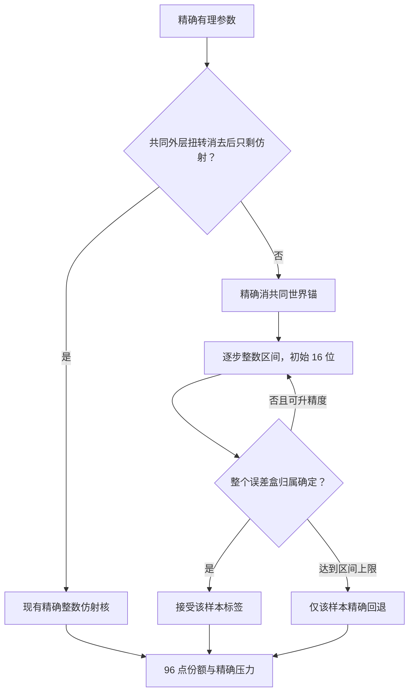

# Nollm：自适应整数区间执行有理几何

任务日期：2026-11-22。接续基线：`ecb71efed2978fa503a8ee99f4006b26143755ad`。

## 1. 本次交付

已将前轮[覆盖精度预算](NOLLM_COVERAGE_PRECISION_BUDGET_20261122.md)提出的执行结构落实为可运行代码：参数保留精确有理语义，非线性链逐步计算整数区间；当整个输出区间足以确定目标格时接受标签，只提高未决样本的精度，最后对剩余点使用原精确有理路径。

这次降低的是实际运算链的中间精度。无需先算出完整的非线性 Fraction 结果再量化。返回的 96 点标签、命中计数、`hits/96`、Q16 输出和当前材料下的压力比较保持原有理数 Lab 合同。

新增 `mode="adaptive"`，接入 `sampled_rational_coverage()`、`evaluate_rational_pressure()` 和 `compare_rational_pressure()`。默认 `mode="auto"` 保持其现有选择。新的执行策略属于独立有理数 Lab；Core 的默认几何、状态和调用方选择保持原合同。

### 最低精度的准确回答

| 问题 | 本轮结论 |
|---|---|
| 任意有理变换全部固定为同一小数位、没有回退，是否存在统一有限最低位数？ | 前轮的单命中边界反例族已否定这一统一门槛。 |
| 有严格区间判定和精确回退，最少可从多少位开始？ | 接口允许从 **0 个二进小数位**开始，最终标签仍遵循精确合同；只是可能做更多工作。 |
| 默认从多少位开始？ | **16 位**，未决点依次尝试 32、64、128 位，再精确回退；这是可配置的成本选择。 |
| 16 位是否就是 float16 或总整数长度？ | 它表示每一步区间端点的二进小数位。格地址、整数部分和有理参数仍保留其完整值。 |
| `max_bits=128` 是否截断真实几何？ | 它只限制区间尝试的精度；剩余点按原参数执行精确判定。 |

## 2. 复用的资产与适配范围

本轮复用[有理几何](../../lab/nollm-lab/geometry/rational_geometry.py)、[公共分母仿射核](../../lab/nollm-lab/geometry/rational_affine_kernel.py)、96 点采样、原 half-even/cube tie 规则、精确支撑及压力聚合，以及前轮的三面裕量推导。

现有 `certified_overlap.DyadicInterval` 面向理想角度的根式与连续面积包围，精度限定为 32–256 位。新执行器复用其整数向下/向上舍入原则，采用轻量整数对支持 0/16 位和逐步有理扭转；独立面积 Oracle 保持原用途。没有重建蜂巢坐标、改变采样点或把连续面积模块接入每次覆盖。

独立算术参考在[新 Oracle 测试](../../lab/nollm-lab/geometry/tests/test_adaptive_rational_oracle.py)中，以显式行列式和扭转标量分子重新计算映射，以直接最小化轴向距离检查唯一归属。它不调用业务映射的 `forward/inverse/_map` 来制造相等结果。

## 3. 执行结构



不同样本保留原标签身份。首轮成功的点不会在下一轮重新计算。对 `initial_bits=0`，递进为 `0,1,2,4,...`，不会卡在 `0×2=0`。每轮从该样本原始有理输入重新计算区间，避免延续已丢失的中间精度。

### 3.1 共同扭转可以只消去有序外层后缀

设两层为

\[
F_s=W\circ V_s\circ A_s,\qquad F_t=W\circ V_t\circ A_t.
\]

则

\[
F_t^{-1}F_s=A_t^{-1}V_t^{-1}V_sA_s.
\]

实现从两侧扭转序列末尾逐项比较，只消去中心、强度、范围完全相同的有序后缀。不同内层扭转保留原顺序；目标剩余扭转依逆序、负强度执行。

完整序列相同时直接复用原整数仿射编译器，不再重建共同锚和两份无用的区间仿射系数。这项简化来自本轮基准发现的实际开销。

### 3.2 共同世界锚在量化前精确消去

对仍有非线性的映射，先从两层世界原点及全部剩余扭转中心减去目标层世界原点。局部锚保持原坐标语义，目标最终格地址保留绝对整数部分。

源仿射先以公共分母整数式产生每个样本的精确分子，再开始区间运算。目标逆仿射也用精确整数行系数作用于输出区间。这样不会先把系数舍入，再把系数误差乘上巨大格地址。

## 4. 逐步误差包围与标签保持证明

令 \(S=2^p\)。内部每个标量以整数对 \([l,h]\) 表示实区间 \([l/S,h/S]\)。所有分母保持为同一 \(S\)，每次非线性运算立即向外舍入。

### 4.1 初值与基本算术

对精确有理数 \(n/d\)，其中 \(d>0\)，初值为

\[
\left[\left\lfloor\frac{nS}{d}\right\rfloor,
       \left\lceil\frac{nS}{d}\right\rceil\right]/S.
\]

加减使用区间端点。乘法取四个端点乘积的最小值与最大值，再除以 \(S\) 向外舍入；平方在跨零时将下端固定为零。乘以精确有理常数 \(n/d\) 时，先按符号确定端点顺序，再用整数除余取 floor/ceil。

正分母区间除法按照分子端点符号选择分母上下端，并向外取整。扭转旋转分母为 \(1+3t^2\)，借助平方区间的非负下界，其分母下界始终至少为 1。

这些操作各自包含真实算术结果。由复合归纳，最后输出的矩形包含原有理映射的真实目标点。

### 4.2 支撑边界使用同一个连续表达式

原扭转在 \(s=N(u)\ge R^2\) 时保持原点，在内部使用二次截止函数。可统一写成

\[
t=k\left[1-\frac{s}{R^2}\right]_+^2,
\qquad [z]_+=\max(z,0).
\]

该式直接计算区间，因此区间跨过支撑边界时也不需要猜测处于哪一侧。正参数 \(1/R^2\) 以精确有理比例作用于区间；例如 \(R^2=2^{-120}\) 不会因为初始仅 16 位而被当作零。

轴向度量满足

\[
N(u,v)=u^2+uv+v^2\ge0,\qquad
N(u,v)\ge\frac{u^2+v^2}{2},
\]

后一式来自 \(N-(u^2+v^2)/2=(u+v)^2/2\)。执行器用这些已知下界收紧区间。只有可信半径下界已达到作用半径平方时，才直接复用输入盒。

### 4.3 整个输出盒必须落入同一格

候选格中心 \((a,b)\) 的严格 Voronoi 内部为

\[
|2u+v|<1,\quad |u+2v|<1,\quad |u-v|<1,
\qquad u=q-a,\ v=r-b.
\]

它对应三角格的六个最近邻。程序从输出盒中点选候选格，按三个线性式在整个矩形上的极值检查六个严格不等式；比较全部为整数操作。

检查通过，则盒中的每个点都以 \((a,b)\) 为唯一最近格，包含在盒中的精确目标点也取该标签。检查未通过，仅表示本次盒不能决定。盒宽为零时可以直接按原 half-even/cube tie 规则判定，保留绝对坐标的奇偶性。

### 4.4 未决点与完整结果

每个样本最终来自严格盒判定、精确 singleton 或原 Fraction 回退三者之一，均遵循同一个精确标签合同。到达区间精度上限不会把未决点当作近似正确。

因此，96 个样本标签保持，随后确定性产生的命中直方图、`hit_count/96`、Q16 输出、固定材料量下的精确支撑和压力、候选变化的旧新覆盖并集均保持。精确回退的计算成本仍取决于实际参数和扭转链；区间上限不构成最坏耗时保证。

## 5. 接口

```python
coverage = sampled_rational_coverage(
    source, target_layer,
    source_map, target_map,
    mode="adaptive",
    initial_bits=16,
    max_bits=128,
)

comparison = compare_rational_pressure(
    upper_units, lower_units,
    upper_layer=0,
    before_upper_map=upper_map,
    before_lower_map=lower_map,
    after_lower_map=candidate,
    inventory_complete=True,
    mode="adaptive",
)
```

诊断入口与覆盖数据分开，避免执行统计改变既有输出字节的含义：

```python
kernel = compile_adaptive_pair(source_map, target_map,
                               initial_bits=16, max_bits=128)
result = kernel.targets_with_stats(q, r, rational_sample_numerators(), 36)
result.targets
result.stats
# sample_count, attempted_by_bits, certified_by_bits,
# exact_fallback, affine_exact, cancelled_common_twists

kernel.enclose_ratio(q_num, r_num, denominator, bits=16)
# q_lo, q_hi, r_lo, r_hi, 2**16
```

误差盒和本次统计是局部计算结果。可复用状态仍是几何系数；不建立源对象到目标对象的持久关系表。

## 6. 实测结果

同一进程交替执行 5 次，取中位数。比较基准为原有理合同的 `auto` 路径；每个重复均在计时外检查完整结果相等。覆盖计时包含编译、所有样本、份额和输出映射；压力计时包含两个完整报告及旧新并集。输入参数、各次时长、命中数和精度统计均在[原始 JSON](../../lab/nollm-lab/geometry/results/adaptive_rational_benchmark_20261122.json)。

| 场景 | 原 auto | adaptive | 原耗时 / 新耗时 |
|---|---:|---:|---:|
| 纯仿射，32 个源格 | 9.364 ms | 8.984 ms | 1.04× |
| 两侧不同扭转，16 个源格 | 398.673 ms | 57.647 ms | 6.92× |
| 共同锚 2^160、不同扭转，7 个源格 | 145.757 ms | 25.699 ms | 5.67× |
| 两步交替中心，1 个源格 | 16.014 ms | 3.362 ms | 4.76× |
| 三步交替中心，1 个源格 | 43.005 ms | 3.984 ms | 10.79× |
| 五步交替中心，全部命中一个目标 | 3540.622 ms | 5.935 ms | 596.60× |
| 五步交替中心，两个目标为 52/44 命中 | 3925.375 ms | 7.115 ms | 551.69× |
| 不同内层、相同外层后缀，1 个源格 | 48.848 ms | 4.501 ms | 10.85× |
| 扭转作用范围外，32 个源格 | 163.799 ms | 73.325 ms | 2.23× |
| 非线性候选压力完整比较，8 个下层格 | 395.179 ms | 49.889 ms | 7.92× |

五步两目标案例保留同一批 96 个样本：16 位认证 80 个，32 位认证其余 16 个，最终命中数为 `(0,0):52`、`(1,0):44`，没有精确回退。较大的倍数来自该固定长链原先的分数分母增长。两侧不同扭转的 1,536 个样本中，16 位认证 1,528 个、32 位认证 8 个，也没有精确回退。

纯仿射初版曾出现额外编译开销：五轮中位数为 auto 11.761 ms、adaptive 15.803 ms。已通过直接复用原编译器结果省去重锚与重复编译，表格采用改后完整重测；初版数据保留在同一 JSON 的 `development_observation`。纯仿射行应解读为相近耗时。

### 起始位数与成本

同一“两侧不同扭转、16 个源格”案例只改变起始位数，仍允许升精度和精确回退。以下五轮计时包含完整覆盖对象，不含 `to_mapping` 投影，因此与上表对应行的计时范围略有差别。

| 初始二进小数位 | 首轮认证样本 / 1,536 | 后续尝试 | 中位耗时 |
|---:|---:|---|---:|
| 4 | 1 | 8 位：1535 点；16 位：1126 点；32 位：8 点 | 135.700 ms |
| 8 | 410 | 16 位：1126 点；32 位：8 点 | 78.310 ms |
| 12 | 1439 | 24 位：97 点 | 64.918 ms |
| 16 | 1528 | 32 位：8 点 | 64.654 ms |
| 24 | 1536 | 首轮全部完成 | 52.203 ms |
| 32 | 1536 | 首轮全部完成 | 74.319 ms |

这一组输入的已测档位以 24 位起步最快；16 位首轮已经认证约 99.48%，两者结果完全相同。4/8 位的重算成本较大，32 位在这些输入上又增加了单次算术成本。默认保留可配置的 16 位；24 位是该案例可以直接选用的成本选项。这里没有推出跨所有扭转链的统一最优位数。

所有这些耗时都是本地 CPython 的固定参数测量。代码正确性由区间包围、最终精确处理和上述交叉核验共同支撑，性能因子按各行实际输入使用。

## 7. 验证范围与复现

整合功能入口实际运行 **145 项测试全部通过，23.032 秒**：前轮 129 项，加本轮 13 项行为测试与 3 项独立 Oracle 测试。源码编译检查通过。本次未以全仓库 CI 作为已完成事实。

行为测试核对双向相对映射、不同与交替中心、共同后缀、真实逐步低精度路径、巨大共同锚、边界单命中、精确份额、Q16、完整与不完整库存、前后候选并集。一个测试禁止调用精确扭转方法，仍完成正常非线性采样，明确确认低精度认证路径没有先算完整 Fraction。

独立 Oracle 覆盖 19 类输入、190 项坐标包含性比较和 19 个最终标签；另有两个从 0 位开始并在 0 位达到上限的回退例子。输入包含 \(2^{180}+1\) 共同锚、\(R^2=2^{-120}\)、行列式 \(2^{-45}\) 的近奇异逆、强度 \(2^{20}\)、支撑边界两侧 \(2^{-70}\)、非二进有理顶点和距面 \(2^{-300}\) 的残差。近奇异用例核验原始点映射包围，其输出可超出存储地址域；覆盖接口的原有地址检查照常执行。

```bash
python3 lab/nollm-lab/geometry/run_support_deformation_tests.py

python3 lab/nollm-lab/geometry/benchmark_adaptive_rational.py \
  --repeats 5 \
  --output lab/nollm-lab/geometry/results/adaptive_rational_benchmark_20261122.json
```

当前执行环境是已与固定主干逐文件核对的部分源码快照，测试范围是支撑压力、变形和本轮区间执行功能切片。对未修改缺席源码的模块归属，复用相同 Git 文件的既有 imports；实际新增与修改源码按 AST 检查。

## 8. 可使用的结论

有理参数继续定义几何；执行器可以只计算足以判断格归属的精度，从而避免常规非线性点的巨大精确分母。靠近判定面的点自动使用更多计算，已经确定的点停止细化。压力机制继续以真实样本份额累计材料，保留原来的建议性质。

本次保证针对原 96 点采样合同。连续边界与面积误差继续使用相应面积 Oracle 研究；需要更换 Core 默认 profile 时，应另行处理该 profile 的参数与兼容合同。

## 9. 方法出处

- [Shewchuk: Adaptive Precision Floating-Point Arithmetic and Fast Robust Geometric Predicates](https://www.cs.cmu.edu/~quake/robust.html)：按判定难度增加精度的先例；本实现使用整数区间及 Nollm 自身的映射公式。
- [CGAL Filtered_kernel](https://doc.cgal.org/latest/Kernel_23/structCGAL_1_1Filtered__kernel.html)：区间过滤与精确谓词的成熟方向，并明确几何构造是否精确须分别判断。本轮直接包围完整有理构造链后再认证格归属。
- [前轮有理架构](NOLLM_RATIONAL_COMPUTATION_ARCHITECTURE_20261122.md)、[精度预算](NOLLM_COVERAGE_PRECISION_BUDGET_20261122.md)保留原合同、边界反例和成本依据。
