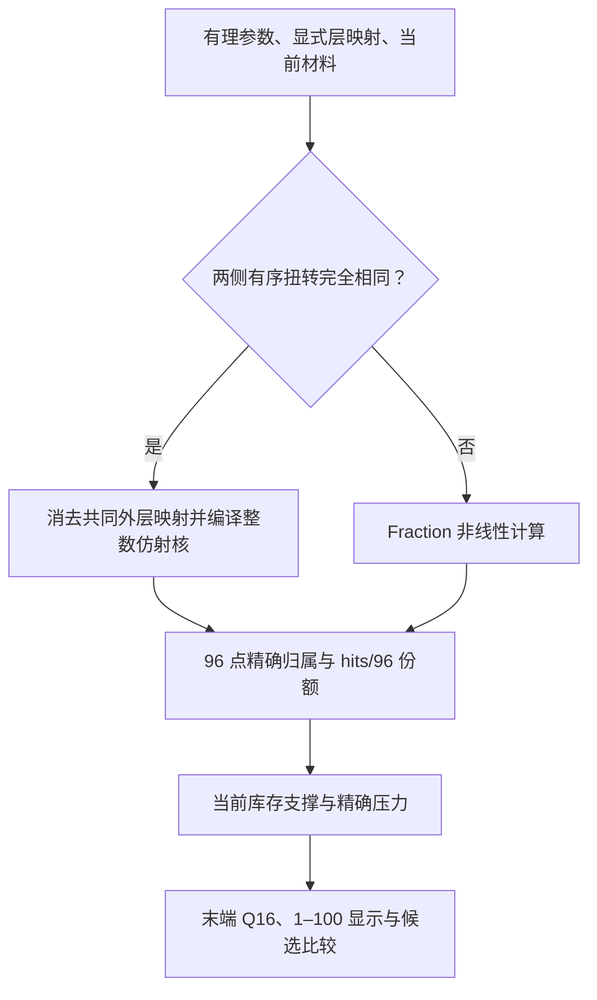

# Nollm 有理数化计算架构

日期：2026-11-22。范围：Nollm Lab 的显式有理几何、覆盖采样和支撑压力计算。

## 1. 架构决定与实现边界

本轮以轴向有理坐标建立独立的 Lab 计算合同：输入采用整数、分数或精确文本；已实现的旋转、缩放、重锚和紧支撑扭转在有理数域内闭合；覆盖归属先精确判定，Q16 和 1–100 分只在输出边界投影。仿射路径编译成公共分母整数核，无法消去的非线性扭转由 `Fraction` 参考路径计算。

这一选择服务于 Nollm 的原生几何关系：当前上下层材料通过覆盖分配支撑，候选网格变换通过覆盖变化比较收益。没有新增对象关系桥、图路由、向量近邻索引或持久化反向关系缓存。编译后的矩阵只保存可重建的几何系数；报告中的 `allocations` 是当次计算结果。

原 Core 的默认 profile、编译常量、Q40/Q16 数值合同和既有存储行为保持。本轮没有自动迁移数据，没有把新的显式 Lab 映射注册成默认层间变换，也没有引入强制下探、自动选址或自动移位。压力结果始终为 `advisory=True`，由 Host 结合语义和实际材料决定下一步。

### 1.1 当前代码对应

| 文件 | 职责 |
|---|---|
| [rational_geometry.py](../../lab/nollm-lab/geometry/rational_geometry.py) | 有理输入、轴向度量、旋转、仿射 frame、扭转、显式 layer map、重锚和序列化 |
| [rational_affine_kernel.py](../../lab/nollm-lab/geometry/rational_affine_kernel.py) | 共同外层扭转消去、相对仿射编译、整数分子归属判定 |
| [rational_coverage.py](../../lab/nollm-lab/geometry/rational_coverage.py) | 96 点覆盖、精确份额、压力评估及旧新覆盖并集比较 |

两个明确的合同标识为：

- 映射：`lab_exact_rational_axial_map_v1`。
- 覆盖：`lab_exact_rational_axial_quadrature_v1`，`share_basis="exact_sample_share"`。

地址继续使用 `GeometryAddress` 的默认轴向地址封装及有效域检查；这不意味着显式传入的 Lab 映射等于 Core 默认 profile 的物理变换。调用者必须同时提供源映射和目标映射，不能仅凭层号推导新家族参数。



## 2. 数值表示与轴向度量

### 2.1 输入保持调用者指定的有理值

`Q(value)` 接受 `int`、`Fraction` 和十进制或分数字符串，拒绝直接传入 `float`。例如 `Q("0.1")` 与 `Q("1/10")` 都表示精确的十分之一；先产生浮点近似，再包装成分数，并不能恢复原先意图。Python 官方 `Fraction` 文档明确区分了浮点值和十进制文本的构造语义，见第 11 节。

序列化使用十进制字符串保存 `numerator`、`denominator`，避免 JSON 消费端把大整数转成有限精度数字。映射对象同时保存自身合同标识。此处提供值对象的序列化，没有新增持久化迁移协议。

### 2.2 去掉坐标表达中的平方根

采用三角格点轴向坐标 \(u=(q,r)^T\)，令

\[
G=\begin{pmatrix}1&1/2\\1/2&1\end{pmatrix},\qquad
N(u)=u^TGu=q^2+qr+r^2.
\]

这保留正六边形的几何度量，同时让坐标、顶点和判定式可以全部使用有理系数。标准 pointy-hex 笛卡尔嵌入为

\[
B=\begin{pmatrix}\sqrt3&\sqrt3/2\\0&3/2\end{pmatrix},\qquad
\|Bu\|^2=3N(u).
\]

实现不需要计算该矩阵；它只用于说明单位。因此 `RationalRadialTwist.radius_squared` 的单位是 \(N\)，原笛卡尔半径 \(R_{\rm cart}\) 对应

\[
\texttt{radius\_squared}=R_{\rm cart}^2/3.
\]

不能把旧接口中的笛卡尔半径平方直接当作同名新参数。修改参数单位和修改扭转规律是独立合同的一部分。

## 3. 有理旋转、缩放和重锚

### 3.1 精确旋转族

令

\[
J=\begin{pmatrix}-1&-2\\2&1\end{pmatrix},\qquad
C(t)=\frac{(1-3t^2)I+2tJ}{1+3t^2},\quad t\in\mathbb Q.
\]

实现直接计算有理矩阵，不需要三角函数。其笛卡尔角度可解释为 \(2\arctan(\sqrt3t)\)，但这只是解释，不是计算路径。

有

\[
J^2=-3I,\qquad J^TG=-GJ.
\]

记 \(a=1-3t^2,\ b=2t,\ d=1+3t^2\)，则

\[
(aI+bJ)^TG(aI+bJ)=(a^2+3b^2)G=d^2G.
\]

因此

\[
C(t)^TGC(t)=G,\qquad \det C(t)=1,\qquad C(t)^{-1}=C(-t).
\]

分母对所有实数 \(t\) 都严格为正。对有理输入和有理参数，结果仍为有理数。一个直观实例是

\[
C(1/3)=\begin{pmatrix}0&-1\\1&1\end{pmatrix},
\]

它表示精确 60° 旋转。有限参数 \(t\) 无法在这张参数图中表示半周旋转；一般 `RationalAffine` 可直接表示 \(-I\)，也有 \(C(1/3)^3=-I\)，无需因此增加新的运行框架。

### 3.2 仿射 frame 与锚点含义

`RationalAffine` 表达

\[
x_{\rm world}=o+A(x_{\rm local}-a),\qquad \det A\ne0.
\]

其中 `origin` 为 \(o\)，`local_anchor` 为 \(a\)。`similarity(scale, rotation_parameter)` 构造 \(A=\sigma C(t)\)，要求 \(\sigma>0\) 为有理数，面积比例为 \(\sigma^2\)。一般构造器还可接受其他可逆有理矩阵；只有旋转和相似变换享有相应的度量保持性质。

`inverse_frame()` 返回真正的有理逆；`self.after(other)` 表示先作用 `other`、再作用 `self`。`reanchor(new_anchor)` 同时重算 origin，使所有点的实际世界位置保持不变。改变表示锚点不等于移动网格，也不应产生覆盖或压力变化。

与此不同，扭转的 `with_center()` 移动实际作用中心，可以改变网格和覆盖，需要重新比较覆盖与压力。`relative_layer_maps()` 则对两侧 origin 和所有世界扭转中心共同减去同一个世界锚点，保持相对几何，只用于缩小中间整数规模；local anchor 保持在局部坐标中。完整 `Fraction` 路径即使不进行这一步，也保持精确平移关系。

## 4. 紧支撑、保面积的有理扭转

设中心为 \(c\)，\(u=x-c\)，\(s=N(u)\)，支撑阈值 \(R^2>0\)，强度 \(k\in\mathbb Q\)。定义

\[
t(s)=\begin{cases}
k(1-s/R^2)^2,&s<R^2,\\
0,&s\ge R^2,
\end{cases}
\qquad
F(x)=c+C(t(s))u.
\]

这是新有理径向规律，不是对既有 float 扭转角度规律的逐位复现。

### 4.1 逆映射和正则性

旋转保持 \(N\)，因此 \(N(F(x)-c)=N(x-c)\)。逆映射会读取相同的 \(s\)，只需把 \(k\) 改为 \(-k\)，无需迭代或求根。中心处没有除以半径的表达式；其导数为 \(C(k)\)。支撑边界上 \(t=0\) 且 \(t'=0\)，函数值与一阶导数连续衔接恒等映射，故全局为 \(C^1\)。这里不主张边界具有更高阶光滑性。

### 4.2 面积保持的代数证明

令 \(K=C^{-1}C_t\)。从 \(C^TGC=G\) 微分得到 \(K^TG+GK=0\)，故 \(u^TGKu=0\)。也可直接计算 \(K=2J/(1+3t^2)\)。于是

\[
DF=C[I+(Ku)(\nabla t)^T],\qquad \nabla t=2t'(s)Gu.
\]

由秩一更新的行列式公式，

\[
\det DF=\det C\,(1+\nabla t^TKu)=1.
\]

多个扭转按序复合仍可逆且保面积，逆计算按相反顺序执行各个逆扭转。若前面存在一般仿射 frame，整张映射的局部面积比例为常数 \(|\det A|\)，并非总为 1。

## 5. 从精确参考运算到整数计算核

### 5.1 共同外层扭转消去

`RationalLayerMap` 先作用仿射 frame，再按顺序作用世界扭转。设两侧有完全相同的有序扭转复合 \(W\)：

\[
F_s=W\circ A_s,\qquad F_t=W\circ A_t.
\]

目标局部坐标中的相对映射为

\[
F_t^{-1}\circ F_s=A_t^{-1}\circ W^{-1}\circ W\circ A_s
=A_t^{-1}\circ A_s.
\]

这是精确恒等式，能直接省掉重复的非线性运算。当前 `compile_affine_pair()` 的实际条件是 `source_map.twists == target_map.twists`，包括顺序、中心、强度和支撑参数；空序列也适用。

实现不做近似相等判定，不假定不同中心扭转可交换，也没有实现部分共同后缀化简。两个不同扭转序列即使在某些输入点上偶然等效，当前仍返回 `None` 并进入参考路径。不能把上述精确消去直接当作旧 float 路径的逐位恒等优化。

### 5.2 公共分母整数编译

相对仿射映射的六个有理系数先取分母最小公倍数 \(D>0\)，编译成

\[
q'=\frac{aq+br+c}{D},\qquad
r'=\frac{dq+er+f}{D},\quad a,b,c,d,e,f\in\mathbb Z.
\]

若输入坐标为 \((Q/H,R/H)\)，则输出可保留为整数三元组

\[
(aQ+bR+cH,\ dQ+eR+fH,\ DH).
\]

不需要在每个样本、每个坐标上构造和约分新的 Fraction。对于共同分母为 36 的采样点，整数源格点的基项也只计算一次，然后叠加各采样偏移。最终 half-even 和 cube 误差比较都可用整数除余及乘法完成。

`CompiledRationalAffine` 保存这些系数；`map_ratio()` 返回精确分子和共同分母，`targets()` 直接输出整组归属。它是相同数学合同的另一种执行方式，不增加中间定点量化。

### 5.3 两种执行模式

| 模式 | 当前执行策略 | 数值合同 |
|---|---|---|
| `mode="auto"` | 可消去时编译相对仿射；否则执行完整 Fraction 映射 | 精确有理输入与归属 |
| `mode="reference"` | 逐点执行源映射，再执行目标逆映射 | 与 auto 相同 |

压力分配在每次请求的每组映射上编译一次，复用到该库存的所有下层格点；不把材料数量写入几何核。两种模式应产生相同覆盖与压力结果。参考路径是语义对照，同时保留不同非线性变换的能力。

## 6. 精确采样、支持度与末端投影

### 6.1 96 个有理采样点

单位六边形的轴向顶点为

\[
\frac13\{(1,1),(-1,2),(-2,1),(-1,-1),(1,-2),(2,-1)\}.
\]

六个扇区各划分成 16 个等面积小三角形，取其质心，得到 96 个带固定位置标签的有理采样点。其坐标均能用共同分母 36 表示。

对源格点中的每个样本 \(p_i\)，计算

\[
u_i=F_t^{-1}(F_s(p_i)),
\]

再执行精确 cube nearest：三个轴先 half-even 舍入，再修正最大误差轴；误差并列时保留既有 q 优先、随后 r 的规则。这里先对精确有理坐标决策，不先投影到 Q40。

目标格点 \(c\) 的份额为

\[
a(d,c)=\frac{\#\{i:\operatorname{nearest}(u_i)=c\}}{96}.
\]

一份源材料在全部命中目标上的份额精确和为 1。返回 `hit_count`、精确 `weight` 和单独的 `weight_q16`；Q16 输出复用现有归一化函数，使总和为 65536。Q16 份额不能回流到本合同的支持度计算。

### 6.2 压力直接消费精确份额

令 \(m(d)\) 为下层格点的当前有效材料量，\(D(c)\) 为候选写入后的上层材料量。实现计算

\[
S(c)=\sum_d m(d)a(d,c),\qquad
P_{\rm exact}(c)=1+99\frac{[D(c)-S(c)]_+}{D(c)+\kappa},\quad\kappa>0.
\]

最后才以 half-up 取显示整数 `pressure`，并返回 `write_weight=101-pressure`。精确值位于 \([1,100)\)，显示值位于 1–100。该权重是同一信号的反向表达，不是概率，也不是独立校准后的效用。

在欠支撑区域，增加上层材料提高压力，增加实际下层支撑降低压力。\(\kappa\) 控制冷启动尺度，不是虚构支撑。调用者如要评估一次候选写入，应把新增材料加入传入数量；函数不会自行推断语义放置，也不会以重复观察制造材料。材料计数的去重和语义复用仍由上游负责，几何支持量不是命题真值或逻辑证明程度。

### 6.3 不完整库存与移位比较

`inventory_complete=True` 声明传入的是该层对的完整有限库存，缺省地址才可以按零材料处理。默认不完整库存下，未知 demand 保留为 `None`；对给定的已知 demand，已供应下层材料只给出支持度下界，压力标为 `upper_estimate`。整体 `total_deficit` 保留未知，不能拿局部观察冒充全域结论。

`compare_rational_pressure()` 在相同材料下比较变换前后，并使用旧覆盖、新覆盖、已知上层格点和显式评估格点的并集。这样不会遗漏移位后退出覆盖的旧目标。结果给出精确缺口变化和覆盖份额变化；`max_known_pressure` 是末端显示分数的统计值。报告供候选判断使用，本身不执行移位或写入。

## 7. 与原 Core 的独立合同

### 7.1 哪些精确性可以同时成立

现有 Core 的 Q40 常量本身是精确的二进有理数；整数运算精确实现其编译合同。相对于理想 22.5° 和 \(2^{1/4}\) 尺度，它们已有编译近似，采样偏移还存在显式定点舍入。

新家族消除了自身计算中的这些中间量化，但选择了新的有理参数。不能同时宣称它精确复现全部理想默认参数、所有系数都属于 \(\mathbb Q\)、并且所有边界输出与旧 Core 一致。当前实现通过独立合同标识和显式映射避免混淆，没有提供默认 `for_layer` 转换。

### 7.2 Q40 之前量化会改变归属

令 \(S_0=2^{40}\)，取

\[
(q,r)=\left(\frac12+2^{-60},0\right).
\]

精确有理 nearest 输出 \((1,0)\)。若先将 q 量化到 Q40，整数分子变成 \(S_0/2\)，half-even 与 cube 修正得到 \((0,0)\)。这是明确的数值合同差异，不能以“误差很小”排除边界行为变化。

### 7.3 Q16 之前投影会改变显示压力

取 demand 为 1、精确支持份额为 \(64/96=2/3\)、\(\kappa=1\)，有

\[
P_{\rm exact}=\frac{35}{2}=17.5,
\]

最终 half-up 显示 18。如果先使用归一化后的 Q16 份额 \(43691/65536\)，则

\[
P=\frac{2293727}{131072}<17.5,
\]

显示变成 17。因此本轮必须保留 `count/96` 到压力公式结束；不能把“都用有理数”误解为不同量化顺序的结果相同。

### 7.4 旧上下方向分别编译，不能当作严格互逆

对 [approximate_coverage.py](../../packages/nollm-core/src/nollm_core/approximate_coverage.py) 中两个方向的轴向 Q40 矩阵，直接整数相乘得到

\[
A_{\rm up}A_{\rm down}-I
=\frac{1}{2^{80}}
\begin{pmatrix}
383171373646&-351505081526\\
351505081526&734676455172
\end{pmatrix}.
\]

新 frame 的精确逆不能同时逐值复制这两个旧方向。现有方向的数值合同继续保留，新的 layer map 则采用真实逆映射。覆盖关系仍须各自计算，不能从矩阵可逆推导出有限采样枚举互为完整反向邻接。

### 7.5 何时才需要代数扩张或有理区间证书

若未来明确要求精确保持原理想角度与尺度，可采用含相关根式的代数数域。例如令 \(\beta^4=2\)、\(\rho^2=2+\beta^2\)，则 \(\mathbb Q(\beta,\rho,\sqrt3)\) 足以表达这些常量，且

\[
\cos(\pi/8)=\rho/2,\qquad \sin(\pi/8)=\beta^2/(2\rho).
\]

这里只给出足够的表达域，不主张其为最小扩张，也没有在本轮实现代数数核。

另一选择是对归属谓词计算有理上下界：区间能证明严格内外关系时直接决策，跨越边界时继续细化。点恰在边界时，单靠区间细化可能不终止，仍需精确等号及 tie 规则。区间证书也不是当前 Fraction 家族已有的默认执行方式。

## 8. 精确采样不等于连续相交面积精确

本轮保证给定有理参数后，96 个样本的映射、归属、计数及由此导出的压力代数精确。它不保证连续网格相交面积的精确值，也没有新增连续覆盖误差界。

扭转保面积使每个原小三角域的面积保持；但原质心的映像一般不是变形后曲边域的质心。等权代表点仍构成既定采样合同，不能据此声称已经精确求出曲边交叠面积。

一个很小的边界移位可能改变真实交叠，却没有任何采样点越界，因而所有计数保持不变。这是有限采样的分辨率限制。若后续决策必须证明连续覆盖变化，需要单独的面积上下界或自适应证书合同；不能让压力报告暗中升级为这一保证。

## 9. 分母增长与成本控制

有理数精确性不会自动带来速度提升。Fraction 运算涉及大整数乘加和归一化；运算次数相同，整数位数不同，成本也会不同。公共分母整数仿射核省掉热循环中的重复分数构造和约分，但最小公倍数本身也可能很大。

计算能力仍受可用内存、整数位数和执行时间约束。使用十进制字符串序列化还受 CPython 的超大整数与字符串转换长度限制：数值在内存中能够表示，不保证 `str(integer)` 或 `int(decimal_text)` 一定成功，超过当前限制可抛出 `ValueError`。本实现没有修改解释器的全局限制，也没有暗中截断分子分母。JSON 字符串方案解决消费端整数精度问题，不表示无资源上限的序列化保证；官方限制说明见第 11 节。

同中心径向扭转保持该中心的 \(N\)，重复作用时每个点所读取的径向参数保持相同。不同中心交替作用会改变这些半径，连续的平方、除法和旋转可能迅速增加分子分母位数。本轮探针从 \((1/4,1/5)\) 开始，采用 `strength=1/5`、`radius_squared=1`，比较重复中心 \((0,0)\) 与交替中心 \((0,0),(1/5,0)\)；第 10.3 节记录逐步位数和精确逆恢复结果。

建议将成本分解为：

| 成本因素 | 可观测量 | 当前可用处理 |
|---|---|---|
| 线性系数编译 | 系数分母、公共分母位数、编译耗时 | 每组相对映射编译一次 |
| 样本判定 | 样本数、分子分母位数、整数归属耗时 | 公共分母与整格基项复用 |
| 非线性复合 | 扭转数量、中心变化、逐步整数位数 | 完全相同外层扭转消去；其余 Fraction 回退 |
| 世界坐标规模 | 公共 origin 的位数 | 显式 `relative_layer_maps()` 重表达 |
| 材料评估 | 下层格点数、覆盖目标数、分配数量 | 几何核复用，库存逐次重新读取 |

优先保留原始样本及映射参数，对候选重新计算，避免把已经投影或重采样的坐标当成新的精确源数据。不得静默调用 `limit_denominator()`、转 float 或回投 Q40 来控制分母；若未来需要近似预算，必须独立声明其合同和误差。当前实现没有承诺非线性链的固定执行上界，也没有新增自动预算切换器。

## 10. 运行、API 与实际验证

### 10.1 可运行的覆盖和压力示例

在仓库根目录执行。此例只处理内存中的有限材料，不写字段、不迁移地址。

```bash
PYTHONPATH=packages/nollm-core/src:packages/nollm-access/src:lab/nollm-lab \
python3 - <<'PY'
from fractions import Fraction as F
from nollm_core import GeometryAddress
from geometry.rational_geometry import (
    RationalAffine, RationalLayerMap, RationalRadialTwist,
    rational_from_mapping,
)
from geometry.rational_coverage import (
    sampled_rational_coverage, evaluate_rational_pressure,
    compare_rational_pressure,
)

def cell(layer, q=0, r=0):
    return GeometryAddress("default_dream_v1", "default", layer, q, r)

shared = RationalRadialTwist(center=(0, 0), radius_squared=4, strength="1/5")
upper_map = RationalLayerMap(twists=(shared,))
lower_map = RationalLayerMap(
    RationalAffine.similarity("4/5", "1/7"), (shared,)
)

# 相同外层扭转可消去；两种执行模式应给出同一份精确结果。
coverage = sampled_rational_coverage(cell(1), 0, lower_map, upper_map)
reference = sampled_rational_coverage(
    cell(1), 0, lower_map, upper_map, mode="reference"
)
assert coverage == reference
assert sum(m.weight for m in coverage.members) == 1
assert sum(m.weight_q16 for m in coverage.members) == 65536
print([(m.target.q, m.target.r, str(m.weight)) for m in coverage.members])

upper, lower = {cell(0): 4}, {cell(1): 3}
report = evaluate_rational_pressure(
    upper, lower, upper_layer=0,
    upper_map=upper_map, lower_map=lower_map,
    inventory_complete=True,
)
assert rational_from_mapping(report["distributed_support"]) == 3
print("total_deficit:", report["total_deficit"])

# 候选移位仅改变本次传入的 frame；函数返回评估，不执行迁移。
moved_lower = RationalLayerMap(
    RationalAffine.similarity("4/5", "1/7", origin=(1, 0)), (shared,)
)
comparison = compare_rational_pressure(
    upper, lower, upper_layer=0,
    before_upper_map=upper_map, before_lower_map=lower_map,
    after_lower_map=moved_lower, inventory_complete=True,
)
print("delta:", comparison["delta"])

# 不同的扭转序列仍支持精确正逆与序列化。
nonlinear = lower_map.with_twist(
    RationalRadialTwist(center=(F(1, 5), 0), radius_squared=1, strength="-1/7")
)
p = F(1, 4), F(1, 5)
assert nonlinear.inverse(nonlinear.forward(p)) == p
assert RationalLayerMap.from_mapping(nonlinear.to_mapping()) == nonlinear
PY
```

### 10.2 复现入口

单独运行有理数相关测试：

```bash
PYTHONPATH=packages/nollm-core/src:packages/nollm-access/src:lab/nollm-lab \
python3 -m unittest discover -s lab/nollm-lab/geometry/tests -p 'test_rational_*.py' -v
```

运行已纳入有理数模块的支撑压力与变形功能切片：

```bash
python3 lab/nollm-lab/geometry/run_support_deformation_tests.py
```

核验应覆盖：旋转恒等式与逆、扭转内外及边界、表示重锚不改变几何、公共大锚下的小位移、auto/reference 结果一致、共同扭转消去、不同扭转回退、96 点守恒、Q40/Q16 两个反例、不完整库存及旧新覆盖并集。有限测试检验实现，前文证明支撑一般代数性质，两者不能相互替代。

### 10.3 本轮实际验证与性能

整合基线为 `d57ce026d4ccea8b2620077329366281d7321978`；以下结果来自与本文一起提交的新源码。环境为 CPython 3.12.14、Linux x86_64，使用标准库，无新增运行依赖。

- 第 10.2 节有理数专属测试入口：**31 项通过，0.221 秒**。
- 整个支撑压力与变形功能切片：**121 项通过，20.714 秒**，包含此前 90 项与新增 31 项。
- 第 10.1 节 API 示例从 Markdown 直接提取执行，全部断言通过。覆盖输出为 `[(0, 0, '1')]`；完整库存的 `total_deficit=1`；候选移位后缺口变化为 `3`，最大已知显示压力变化为 `59`。
- 当前测试和基准没有失败项。已知资源边界为整数规模、非线性分母增长和十进制转换限制；没有承诺任意深度非线性链的可接受耗时。

性能比较使用同一套新有理数合同的 `reference` 与 `auto`。它不是与既有生产 Core 的对比，也不把上一轮 EM 算法测量重复算作本轮收益。每个样例先执行两种模式预热，之后进行 5 次交替顺序计时；下表为中位数。所有完整结果逐项相等，检查在计时外进行。

| 完整操作 | Fraction reference | auto | reference / auto |
|---|---:|---:|---:|
| 仿射覆盖，64 个源格 | 156.758 ms | 14.828 ms | 10.57× |
| 共同世界锚 2^160 且保留 +1 偏移，64 个源格 | 157.129 ms | 13.903 ms | 11.30× |
| 完全相同的两段世界扭转，8 个源格 | 305.215 ms | 1.920 ms | 158.97× |
| 不同世界扭转，16 个源格 | 109.461 ms | 108.491 ms | 1.01×，没有可确认的提速 |
| 完整候选压力比较，32 个下层格、两个候选 | 162.382 ms | 16.927 ms | 9.59× |

覆盖批量计时包括逐格调用时的相对映射编译和返回 mapping 构造；压力计时包括每候选一次编译、所有下层覆盖、两份完整压力报告及其并集比较。没有单独拆分编译耗时；它已计入总时间。映射参数预先解析，样本常量缓存预热；JSON 文本编码、写盘和相等断言不计入。共同扭转的较大收益来自精确代数消去，不能外推到不同扭转；后者仍执行相同参考运算。

分母增长探针记录两坐标的分子、分母中最大整数位数：

| 扭转次数 | 始终同中心 | 两个中心交替 |
|---:|---:|---:|
| 1 | 42 | 42 |
| 2 | 81 | 241 |
| 3 | 121 | 1,223 |
| 4 | 160 | 6,134 |
| 5 | 199 | 30,692 |

同中心继续到第 9 次为 357 位；交替中心只执行到第 5 次，该次单点正向计算为 16.067 ms。每一步均用精确逆恢复上一步输入。这里是固定探针，不是位数增长定理，也不是整层覆盖或服务吞吐测试；所有逐次时长和参数保留在原始 JSON 中。

复现完整基准：

```bash
python3 lab/nollm-lab/geometry/benchmark_rational_geometry.py \
  --repeats 5 \
  --output lab/nollm-lab/geometry/results/rational_architecture_benchmark_20261122.json
```

[基准脚本](../../lab/nollm-lab/geometry/benchmark_rational_geometry.py)是显式运行的实验工具，不增加时间阈值或 CI 门禁；[原始结果](../../lab/nollm-lab/geometry/results/rational_architecture_benchmark_20261122.json)保存环境、输入、全部重复时长、位数和相等性结果。

模块所有权整合使用固定完整 Git 文件清单、当前可用 Python 源码的 AST 和未改动缺席文件的既有 canonical imports；新模块沿用 `lab:support-deformation`，并核对受影响 Lab 的公开接口依赖及 Core API allowlist。当前环境是部分源码快照，**未声称运行整个仓库的全源码 validator 或全部 CI**。功能证据为上述明确的 121 项切片。

## 11. 资料与审查依据

### 项目实现与既有设计

- [支撑压力与几何变形设计审查](NOLLM_SUPPORT_PRESSURE_AND_GEOMETRIC_DEFORMATION_REVIEW_20261122.md)：局部建议压力、材料守恒及原生覆盖原则。
- [支撑压力与变形实现说明](../project/NOLLM_SUPPORT_PRESSURE_AND_DEFORMATION_IMPLEMENTATION_20261122.md)：既有实现范围与功能切片入口。
- [Core approximate coverage](../../packages/nollm-core/src/nollm_core/approximate_coverage.py)：Q40 常量、采样舍入和上下方向。
- [Core fixed point](../../packages/nollm-core/src/nollm_core/fixed_point.py)：Q16 权重归一化。
- [Core GeometryAddress](../../packages/nollm-core/src/nollm_core/geometry.py)：地址合法域。

### 官方外部资料

- Python 3.12 `fractions`：https://docs.python.org/3.12/library/fractions.html 。用于核对分数构造、约分、round 和 `limit_denominator` 语义。
- Python 3.12 整数字符串转换长度限制：https://docs.python.org/3.12/library/stdtypes.html#integer-string-conversion-length-limitation 。用于说明内存中的精确整数与十进制序列化的不同资源边界。
- CGAL 2D and 3D Linear Geometry Kernel：https://doc.cgal.org/latest/Kernel_23/index.html 。用于精确谓词与构造、精确算术成本、公共分母表示及含根数值类型的工程背景。
- CGAL Kernel Design：https://doc.cgal.org/6.0/Manual/devman_kernels.html 。用于齐次坐标与有理坐标的表示关系。

前文旋转、扭转和合同反例由给出的公式及当前源码直接推导；外部资料不被用来替代这些证明。该工作是 Nollm 工程中的数学应用，没有建立 EM 研究记录，也不据此主张新的数论研究成果。
