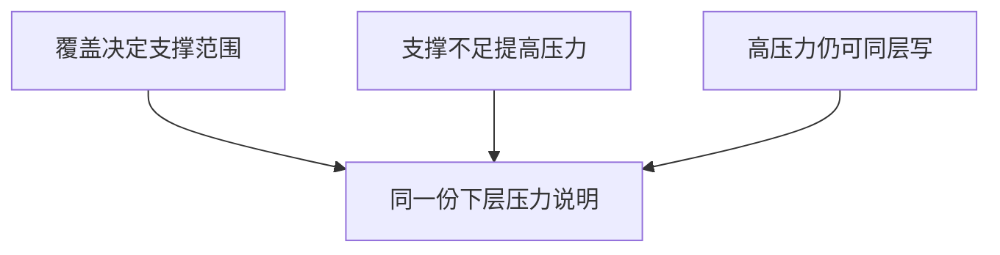

# Surface 本身就是缩影：写入时形成非树蜂巢的分层记忆

日期：2026-11-23。源码与原场审查基线：`55871fc6b6b0e21c4a4c7e2297ae67dadbab1d15`。

本轮性质：用户纠正后的架构研究、当前场审计和已执行原生试验。试验复用现有多层写入、Surface 与 Coverage；完整存放策略、入口/写入范围分离和按层局部 I/O 尚待实施。

## 1. 本次纠正与设计决定

用户指出：第一层 Surface 本身应当是提炼后的缩影，只有沿相邻层往下走才遇到更多内容。如果表层的全量读取已经过大，应该首先检查存放时是否把内容拆细、提炼和分层，而不是再从所有完整材料上派生一份缩影。各层关系继续由非树蜂巢覆盖组织。

**采用这个方向：Surface 从真正存放在浅层格里的短判断开始；条件、解释、案例与细节保存在更细的物理层；原始 Evidence 和历史版本完整保留。** 短判断由真实 LLM 形成，有来源、有版本、有物理位置。读取表层时直接读取这些短正文，而不重新扫描深层材料生成摘要。

上一份[相邻 p8 与容量方案](NOLLM_ADJACENT_P8_CAPACITY_PLAN_20261123.md)把局部持久化与分页列为容量首要工作，主次需要调整：先完成可用的分层形成，再让持久化和读取实现遵守它。8 个局部二进小数位、96 点与完整整数地址的选择继续有效。

本次用户明确允许短缩影作为上层内容。第一性原理中“一段独立、有意义、可回到原文的表达”继续成立；短判断属于这样的表达。旧文“最小单位不是摘要”不应被扩展为禁止上层语义提炼。机械截断、空泛标签和用缩影代替事实原文仍不能承担完整记忆职责。

## 2. 当前存放方法的实际缺口

### 2.1 Surface 当前展示的是来源片段

| 实现 | 基线行为 | 缺口 |
|---|---|---|
| Core `SurfaceCellProjection` | 计数、质量、来源格与标志，没有语义正文 | 聚合观察格本身没有已保存的概括判断 |
| `build_surface_orders()` | 遍历 scope 中占用，逐阶提升几何投影并合并来源 | 更高观察阶没有形成更概括的语义 |
| Access `_view()` / `_previews()` | 取得来源格全部 handle 与 statement 后，显示前三条及前256字符 | 显示截短没有改变实际存放的内容 |
| `project_memory.encounter()` | 同一 layers 同时控制首屏 Surface 范围与可写范围 | 只观察表层和在深层写入无法独立表达 |
| 语义写入策略 | 校验层、地址等，默认 L0，显式可多层 | 没有按层检查单格正文总量和表层总量 |
| `formation.py` | 按选中的 Evidence 跨度提取原句 | 原文锚定工具没有替 Host 完成概念提炼 |
| 支撑压力 | 当前 Atom 为材料单位 | 十几个字与一千字都算一个 Atom，不能独自限制表层膨胀 |

源码：`packages/nollm-core/src/nollm_core/surface.py:135–153,210–290`；`state.py:341–358`；`packages/nollm-access/src/nollm_access/surface_navigation.py:569–623`；`statement.py:7–19`；`write_policy.py:32–81`；`formation.py:239–249`；`support_pressure.py:103–129`；`lab/nollm-lab/repository_memory/project_memory.py:225–278`。

旧[项目缩影设计](../../lab/nollm-lab/repository_memory/PROJECT_MINIATURE_DESIGN.md)明确记录过“全部判断先放 L0、空粗层只负责传播”的过渡用法。本轮推进的正是当时尚未形成的内容层次。

### 2.2 活跃速记本也存在同样问题

对基线场的只读统计：

| 指标 | 实际值 |
|---|---:|
| 当前表达 | 23 |
| 当前占用格 | 21 |
| 物理层分布 | 23 条全部在 L0 |
| 当前正文总量 | 10,724 Unicode 字符 / 24,577 UTF-8 字节 |
| 正文中位数 / 最大值 | 384 / 1,037 字符 |
| 超过256字符预览长度 | 21 / 23 |
| 所有当前表达的首行合计 | 596 字符 |

上一轮新写的 `nollm.capacity.v1` 正好最长，1,037 字符。这说明工作方法也需要改：不能一边研究简短表层，一边把整篇设计说明直接加入同一表层。

完整逐项统计见 [stored_surface_before_20261123.json](../../lab/nollm-lab/repository_memory/results/stored_surface_before_20261123.json)。这是修改前固定版本的观察，不是以后版本的实时计数。

## 3. 保存什么：短判断、展开判断和证据

### 3.1 每一层保存完整但粒度不同的意思

表层负责让 Host 看懂有哪些值得进入的判断；相邻细层负责展开条件与机制；更深处保留具体证据、案例和变化。绝对层号不固定为某一种主题，场可以声明自己的表层物理位置。

以已有量化研究为例：

| 位置角色 | 可保存的正文示例 |
|---|---|
| 表层 | `局部8位，地址独立。` |
| 相邻细层 | `8位描述格内余量，整数锚保留完整地址范围。` |
| 更细层 | `共同平移与长度单位先消去；矩阵不能先量化再乘巨大地址。` |
| 具体材料 | 768标签探针的条件、参数、结果与固定源码引用 |

这些是 Host 形成的示例，不由字符串截断产生。另一个上层判断可以从“细层分辨率”角度覆盖同一份下层解释。下层不必为每个上层复制一份。

粒度按实际意思选择。`几何`、`容量`只有主题名；`局部8位，地址独立`已经表达关系。`Q16仅作输出`省略了合同范围，宜写为`有理Lab：Q16末端输出`。提炼应压缩重复叙述，保留否定、条件、对象与状态。

### 3.2 Surface 文字属于原生记忆

上层短判断继续使用 `MemoryStatement`、当前绑定和普通物理格，拥有自己的 Evidence 来源及修订历史。Surface 视图可以重建，视图读取的短正文需要真实持久化。

不保存 `summary_id -> child_ids`、独占 parent 或“词项到入口”的表。下层集合在本次访问时按几何算出；来源引用用于已经遇到表达后的回源。一次阅读的返回栈只是本次导航状态。

相同事实在不同粒度下出现时，上层只保存重新形成的概括，下层保存新的区分或细节；不把整份事实正文复制到每个参与覆盖的格。原文和历史存储的增长按真实材料计算。

## 4. 限制什么：存入的体量与一次观察的体量

只限制每条字数，会产生无限多短条；只限制每格条数，会产生很长的条目；只限制页面，会产生无限页。因此本轮将约束分成三项：

1. **单格内的当前表达数量和正文总字节。** 使用 UTF-8 字节计算，多个表达合计。
2. **整个首层入口面的占用格数和正文总量。** 首屏分页不替代整个表层的内容预算。
3. **每次局部展开返回的正文与元数据量。** 限制本次实际读取，不要求全域细层只有少量格。

### 4.1 首轮可试的配置

以下数值是研究起点，尚未用冷读任务测出最佳值，也没有写成全项目强制默认：

| 量 | 首轮试验值 | 目的 |
|---|---:|---|
| 当前首层入口面占用格 | 至多16格 | 首层完整观察保持紧凑 |
| 一个表层格的当前短表达 | 至多2条 | 控制对象和元数据开销 |
| 一个表层格的正文合计 | 至多128 UTF-8字节 | 约40个普通汉字，保留完整短判断 |
| 首层正文总量 | 至多2 KiB | 由上面两个存放限制共同约束 |
| 首轮返回总量 | 至多8 KiB | 另计并约束必要可见元数据；完整来源按回源动作打开 |
| 后续局部窗口 | 同时声明格内体量与窗口返回量 | 随粒度增加可保存更完整说明，但不整层全读 |

不规定每个物理层全域都只能有16个格。下层可以在实际空间里容纳更多格和材料，单次只展开当前入口的覆盖现场。“每层多少子集”在这里落实为实际格的数量和局部体量，不落实为父对象拥有固定数量子对象。

### 4.2 满了以后如何存放

Core 返回当前体量和已观察的合法几何位置，Host 决定：复用或修订已有短判断；将独立细节放到更细层；在局部相邻格区分不同意思；必要时形成一个真实更粗的表层。放不下的原文先 Capture，保留明确的待形成状态。

不截断长正文后假装已提炼，也不因为表层满而丢弃原始材料。关于数量和字节的约束是此次用户要求的表层组织规则；它与原来的建议压力分开。高支撑压力仍只是下探参考，字节超限则要求重新选择当前写入内容或位置，不能把“忽略压力”当作放入任意长正文的许可。

## 5. 怎么用：表层一次看完，细节按相邻覆盖展开

读取某个受控的小表层可以是一次全读。需要取消的是每次为得到这块表层而扫描全部深层材料。

预期主路径：读取场配置确定的物理表层，显示该层已存短判断；Host 选择一个真实物理入口；计算相邻更细层的覆盖和局部占用；读取这个局部的下一层表达；按当前问题继续向下或回源。每条覆盖仍只跨相邻物理层。

`Physical Memory Layer`、语义提炼粒度和 `Aggregation Order` 继续区分。观察阶可以用于显式几何诊断，不再承担从全场长正文制造日常语义入口的职责。需要重新整理整体结构时可以执行一次全场工作；普通读取直接复用已形成的表面。

### 5.1 拆开当前混在一起的层范围

当前 `encounter(layers=...)` 将同一范围交给 Surface 和可写候选。试验用 `layers=(-1,)` 时，表层只显示 L−1，实际 Recall 能继续到 L0，但可写候选仍只有 L−1。改为 `(-1,0)` 又会把细层加入首屏聚合。

实施时在现有适配器中分别表达：

- 入口表层范围：这一次从哪些已有物理表层读取短判断；
- 局部观察/写入范围：从已选入口允许向哪些相邻层形成和维护内容。

保持同一入口与实际显示的候选。扩大局部写入层范围不等于重新选择全局入口。源/关键词索引不参与这个选择。

## 6. 怎么维护：写入时支付形成成本，日常读取复用结果

新材料先保存 Evidence。Host 阅读已有表层并进入相关现场，对照当前判断形成增量：已有概括仍然成立时，只补充合适的细层材料；出现新的条件或反例时，改写受影响的短判断，并按几何向更粗层检查。没有语义变化的层不必追加正文或重做摘要。

影响范围由实际相邻 Coverage 与局部占用给出。多目标重叠可能影响几个上层格，都应允许参与维护；不选一个永久父节点作为唯一责任人。上下方向的采样集合不互为精确逆，维护时要明确所用方向；下钻可达性按真实阅读方向检查，不通过对象反向表补成树。

暂未处理的新证据保留为已 Capture、尚待形成；受其影响且尚待复核的表达如实标识当前维护状态，不自动删掉旧版本，也不把未复核的概括称为新事实。使用现有状态/事务表达这个过程，不再建立一套审计控制平台。

首次导入和真正的大范围重组需要读入相应材料。这项成本属于形成或维护；成熟表层的常规读取不重复支付。局部变化通常只需局部工作，改变全场意义的证据可能需要更大范围重新形成。

## 7. 已执行的原生试验

脚本：[probe_stored_surface_formation.py](../../lab/nollm-lab/repository_memory/probe_stored_surface_formation.py)。
完整输出：[stored_surface_formation_20261123.json](../../lab/nollm-lab/repository_memory/results/stored_surface_formation_20261123.json)。

使用已有原生 API 和明确的多层写入策略，在一次性试验场写入三条 Host 短判断，并把原速记本 `nollm.pressure.v1` 完整正文保存在相邻细层。原场未因该试验改变。

| 物理位置 | 已保存正文 | 字符 / UTF-8字节 |
|---|---|---:|
| L−1(0,0) | 覆盖决定材料的支撑范围。 | 12 / 36 |
| L−1(1,0) | 支撑不足提高写入压力。 | 11 / 33 |
| L−1(0,1) | 高压力仍允许同层写入。 | 11 / 33 |
| L0(1,0) | 原有压力判断的完整正文 | 384 / 931 |

表层合计 **34字符 / 102字节**，三个片段都是完整保存的短正文，首屏没有截断。首屏的 `FileStatementStore.get` 只调用这三条上层表达。



从三个上层格分别选择单一物理入口，都通过一步 `coverage_down` 逐字取回同一份下层正文，三条实际向下命中分别为 **4/96、41/96、22/96**。下层向这三个上层的命中分别为 **7/96、56/96、29/96**，另有一个未占用上层格命中4/96。方向份额没有被假定相等。

试验场共4个占用格、零桥，没有父子ID表；正文和位置由 Host 为示例选择。这证明现有底座能够表达共享展开的非树结构，并非独立语义召回质量评估。

同时记录到首屏仍整读 `current_state.json` 两次，每次2,380字节，其中包含下层载荷。因此实际证据是“Surface 的 statement 正文读取只选短表层”，不是“底层 I/O 已有界”。把存储读取改为只接触指定层/格，是服务于这一组织方式的后续工作。

复现：

```bash
python3 lab/nollm-lab/repository_memory/probe_stored_surface_formation.py \
  --output /tmp/nollm_stored_surface_formation.json
```

脚本自动创建并清理一次性场，不改活跃速记本。它使用现有默认 Core Coverage；本轮没有实现或切换 p8 几何合同。

## 8. 容量含义与应测量的结果

内容被正确提炼后，上层不再随每条证据等比例追加完整文字。原文、历史和更细的有意义区分继续占真实空间；把正文拆层不消除这些字节，也不把全部语义关系变成树。

固定世界区域内，现有几何每细一层格密度约乘√2；深度d的面积密度倍率约为 `(√2)^d`。覆盖中的多个目标会重合，不能用“每格若干目标”当作独立分叉，推导出8^d容量。细层还可以利用更多物理区域，实际容量按真实占用与字节计量。

表层有固定体量时，不承诺它无损枚举任意多独立事实。它应提供足够区分的概括，让 Host 逐步进入相关现场；当现有概括失去区分力时，重新形成或调整实际层次。判断是否够用，应看问题能否沿真实路径找到条件与证据。

最有价值的验收包括：

- 首屏实际保存的正文总量、条数与完整性；没有靠 `text[:n]` 达标。
- 已形成场的冷启动不读取深层正文，底层实际读页/字节也符合该路径。
- 从不同上层角度可进入同一份下层材料；没有复制全文或独占父关系。
- 少量新增支持材料不会使首层逐条增长；反例或条件变化能引起适当修订。
- 用未参与布置的问题检查入口选择、必要条件、稀有事实与最终回源，分别记录“几何可达、实际返回、Host读到、回答正确”。
- 同时记形成和维护成本；展示字数节省不被表述为已测总耗时优势。

## 9. 更新后的实施顺序

1. **先形成一份真正分层的速记本对照场。** 用现有判断由 LLM 提炼短表层，细分条件和机制，保留原文与旧场，实际选择几何位置并检查阅读方向。
2. **让现有 encounter 支持只看表层、在深层维护。** 拆开入口范围和局部写入范围，落实物理格的正文与条数预算，超限交回 Host 重新形成。
3. **沿这个使用路径改局部存储。** 消除首屏的整场载入、全场投影与深层预览读取；按已知几何地址读写，不引入外置语义入口索引。
4. **用真实冷读和维护任务调整预算。** 对表层区分力、共享覆盖、稀有条件和增量修订作比较，再决定是否扩大或收紧试验值。

当前交付已完成本报告、固定原场统计和可复现原生试验。字节预算、完整场的重新形成与生产读取改造仍属于实施项；本轮不会把少量示例的成功当作全场迁移完成。

## 固定来源

以下代码与原场共同固定于 `55871fc6b6b0e21c4a4c7e2297ae67dadbab1d15`：

- [第一性原理](https://github.com/awdawmip/Nollm/blob/55871fc6b6b0e21c4a4c7e2297ae67dadbab1d15/docs/architecture/NOLLM_FIRST_PRINCIPLES_AND_ANTI_DRIFT_20260711.md)
- [旧项目缩影设计](https://github.com/awdawmip/Nollm/blob/55871fc6b6b0e21c4a4c7e2297ae67dadbab1d15/lab/nollm-lab/repository_memory/PROJECT_MINIATURE_DESIGN.md)
- [Core Surface](https://github.com/awdawmip/Nollm/blob/55871fc6b6b0e21c4a4c7e2297ae67dadbab1d15/packages/nollm-core/src/nollm_core/surface.py)
- [Core 状态](https://github.com/awdawmip/Nollm/blob/55871fc6b6b0e21c4a4c7e2297ae67dadbab1d15/packages/nollm-core/src/nollm_core/state.py)
- [Access Surface](https://github.com/awdawmip/Nollm/blob/55871fc6b6b0e21c4a4c7e2297ae67dadbab1d15/packages/nollm-access/src/nollm_access/surface_navigation.py)
- [项目原生相遇与写入](https://github.com/awdawmip/Nollm/blob/55871fc6b6b0e21c4a4c7e2297ae67dadbab1d15/lab/nollm-lab/repository_memory/project_memory.py)
- [Formation 原文跨度](https://github.com/awdawmip/Nollm/blob/55871fc6b6b0e21c4a4c7e2297ae67dadbab1d15/packages/nollm-access/src/nollm_access/formation.py)
- [写入策略](https://github.com/awdawmip/Nollm/blob/55871fc6b6b0e21c4a4c7e2297ae67dadbab1d15/packages/nollm-access/src/nollm_access/write_policy.py)
- [支撑压力](https://github.com/awdawmip/Nollm/blob/55871fc6b6b0e21c4a4c7e2297ae67dadbab1d15/packages/nollm-access/src/nollm_access/support_pressure.py)
